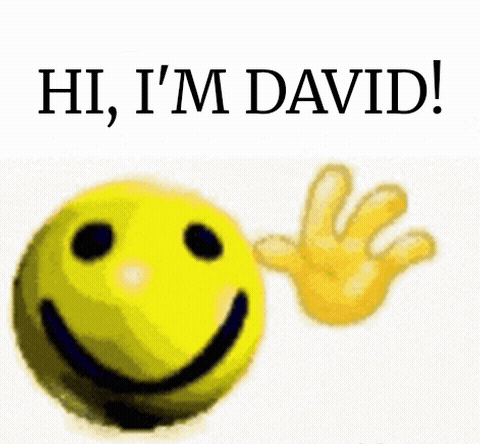

   
  
  
  <h1>What's cooking?</h1>
  

    

      <blockquote><italics>It's goin' on in the kitchen, but I don't know what's cookin'</italics></blockquote>
      <ul>
        <li>robotics team website</li> 
        <li>discord bot for robotics team</li>
        <li>school cli utils (too lazy to reach for my calculator when doing math, chem or phys etc.) (may just end up dumbing down to a mere python script xd)</li>
        <li>flashbang script to provide "graceful reminders" to help me fix my sleep schedule</li>
        <li>blobcat collection (not really a project but whtv lol)</li>
        <li>possibly an omnisearch-like extension for chromium browsers</li>
        <li>portfolio website/blog website (place to display my poetry 🤷‍♂️)</li>
        <li>do sm research and go thru pain of designing a cryptography convention just to find out it wont work 🥶</li>
        <li>paranoid/supa dupa strict firewall whitelist for my apps (spotify bro i swear you do NOT need allat)</li>
      </ul>
    

  

  
 <h2 align="center">Let's Connect!</h2>
  

    
    
    
  

<h2 align="center">GitHub Stats:</h2>
<small><blockquote>lost 3k commits when i changed emails :blobsad:</blockquote></small>

   
  
  

<!-- <h2 align="center">Competitive Programming Stats</h2> -->
<!-- 
 -->
  <!--  -->
  <!--  -->
<!-- 
 -->
